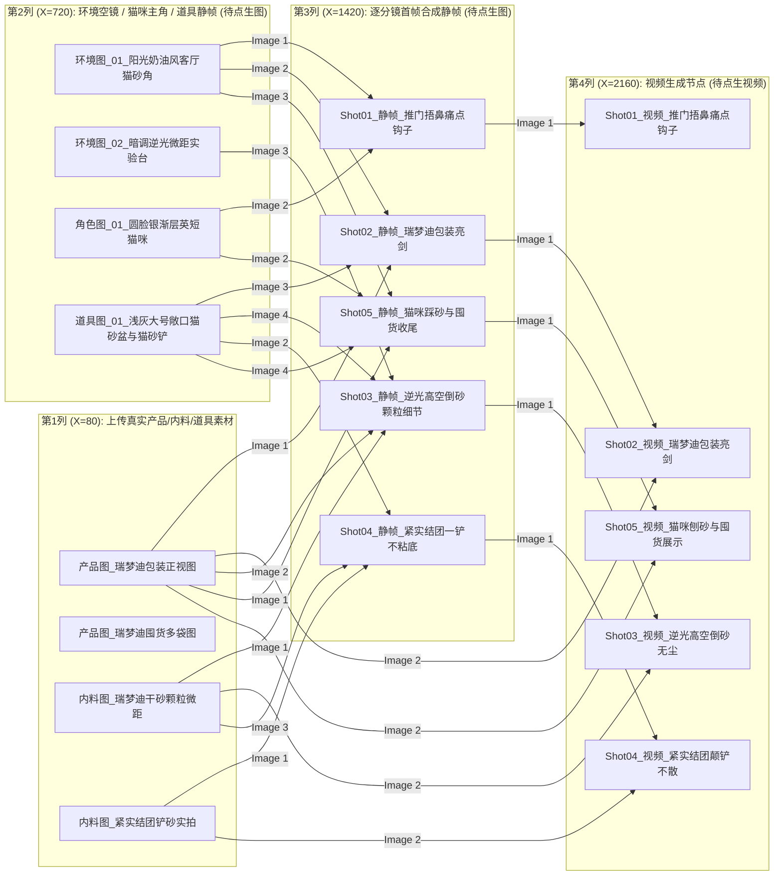

# 瑞梦迪5合1混合猫砂_18s痛点实证模板 — 静帧/道具/视频提示词与 LibTV 画布节点连线总表

> **执行状态声明**：本方案遵循「零自动扣费预连线模式」，所有生图与生视频节点均**未附加 `--run`**，请进入画布后从左至右依次人工确认点击生成。

## 资产预检提醒
- 【必补传】 本地暂未检测到 `products/reymon-cat-litter/assets/packshots/pack_front.png`，已在第1列创建同名占位提示节点 `产品图_瑞梦迪包装正视图`，进画布后可直接替换为实拍图。
- 【可选补传】 本地暂未检测到 `products/reymon-cat-litter/assets/packshots/pack_stack.png`，已在第1列创建同名占位提示节点 `产品图_瑞梦迪囤货多袋图`，进画布后可直接替换为实拍图。
- 【必补传】 本地暂未检测到 `products/reymon-cat-litter/assets/inner_granules/granules_macro.png`，已在第1列创建同名占位提示节点 `内料图_瑞梦迪干砂颗粒微距`，进画布后可直接替换为实拍图。
- 【必补传】 本地暂未检测到 `products/reymon-cat-litter/assets/inner_granules/clump_scoop.png`，已在第1列创建同名占位提示节点 `内料图_紧实结团铲砂实拍`，进画布后可直接替换为实拍图。

## 一、 LibTV 无限画布 4 列节点连线拓扑图

## 二、 第 1 列：需挂载的真实产品素材与内料/道具清单

| 画布节点名 | 类型 | 本地文件路径 | 必传 | 用途说明 |
| :--- | :--- | :--- | :--- | :--- |
| `产品图_瑞梦迪包装正视图` | `image` | `products/reymon-cat-litter/assets/packshots/pack_front.png` | 是 | 瑞梦迪猫砂单袋正面高清实拍图，锁定袋身Logo、字体与2.5kg袋型比例 |
| `产品图_瑞梦迪囤货多袋图` | `image` | `products/reymon-cat-litter/assets/packshots/pack_stack.png` | 可选 | 4袋/8袋囤货装堆叠实拍图，用于片尾性价比逼单镜锚定 |
| `内料图_瑞梦迪干砂颗粒微距` | `image` | `products/reymon-cat-litter/assets/inner_granules/granules_macro.png` | 是 | 奶白豆腐条+木薯膨润土细粒+除臭颗粒微距实拍，锁死真实内料配比 |
| `内料图_紧实结团铲砂实拍` | `image` | `products/reymon-cat-litter/assets/inner_granules/clump_scoop.png` | 是 | 猫砂铲铲起完整紧实圆饼猫砂团实拍图，锁死结团形态不散裂 |

## 三、 第 2 列：环境空镜 / 猫咪角色 / 道具静帧提示词

### `环境图_01_阳光奶油风客厅猫砂角`（类型：`environment`）
- **上游连线**：无（纯文生图基底节点）
- **静帧提示词**：
  > 竖屏 9:16 商业家居摄影空镜，中景蹲姿偏低机位。现代温馨奶油风客厅一角，浅橡木地板干净整洁，右侧落地纱帘洒入柔和明亮的自然侧逆光，画面中央偏下留出宽敞平整的地板区域用于放置猫砂盆与猫砂包装。真实单反景深，无人物、无文字、无水印。

### `环境图_02_暗调逆光微距实验台`（类型：`environment`）
- **上游连线**：无（纯文生图基底节点）
- **静帧提示词**：
  > 竖屏 9:16 商业广告高速摄影暗调背景空镜。深暖灰纯净虚化背景，侧后方打入一束清晰干净的聚光逆光光束（专门用于衬托倾倒猫砂时空气通透无粉尘的质感），下方为干净平整的木质台面。无杂物、无文字、无水印。

### `角色图_01_圆脸银渐层英短猫咪`（类型：`character`）
- **上游连线**：无（纯文生图基底节点）
- **静帧提示词**：
  > 竖屏 9:16 宠物商业摄影定妆照，纯净浅米色背景。一只圆脸健康的银渐层英短猫咪，毛发蓬松柔顺，绿色圆大眼机灵可爱，全身蹲坐姿态自然完整。真实毛发微距质感，无卡通感、无文字水印。

### `道具图_01_浅灰大号敞口猫砂盆与猫砂铲`（类型：`prop`）
- **上游连线**：无（纯文生图基底节点）
- **静帧提示词**：
  > 竖屏 9:16 产品静物摄影，纯净浅灰背景。一个极简浅灰色大号敞口猫砂盆（空盆），盆边搭配一把同色系宽面镂空猫砂铲，哑光磨砂PP塑料材质真实清晰，比例结构准确无扭曲，无文字水印。

## 四、 第 3 & 4 列：逐分镜首帧静帧提示词、视频提示词与槽位连线

### Shot01：黄金3秒痛点钩子_捂鼻嫌弃与粘底崩溃（`00:00 - 00:03` | 路由：`A_PURE_AI`）
- **口播台词**：下班一开门这股猫尿味！铲屎还像铲水泥一样粘盆底，真的会谢！
- **第 3 列首帧节点**：`Shot01_静帧_推门捂鼻痛点钩子`
  - **连线槽位**：`{{Image 1}}` ← `环境图_01_阳光奶油风客厅猫砂角`，`{{Image 2}}` ← `角色图_01_圆脸银渐层英短猫咪`
  - **首帧静帧提示词**：
    > 竖屏 9:16 生活感实拍风格静帧。在 {{Image 1}} 的客厅视角中，前景年轻女性铲屎官一手捏住鼻子皱眉表情痛苦崩溃，地面旁 {{Image 2}} 的银渐层猫咪也一脸嫌弃地扒拉地板不愿进旧砂盆。生活化强反差情绪张力，画面上下预留 18% UI 安全区，无文字无水印。
- **第 4 列视频节点**：`Shot01_视频_推门捂鼻痛点钩子`（时长：`4s`）
  - **连线槽位**：`{{Image 1}}` ← `Shot01_静帧_推门捂鼻痛点钩子`
  - **视频动态提示词**：
    > 以 {{Image 1}} 为起始首帧。动作走向：年轻铲屎官皱紧眉头一手捂鼻、另一只手在鼻前猛扇异味连退半步，地上的银渐层猫咪嫌弃地甩了甩前爪扭头走开。运镜：手持纪实感快速急推镜头（Fast Push-in）聚焦崩溃神态，前3秒强视觉留人节奏。无文字、无水印。

### Shot02：瑞梦迪猫砂包装亮剑登场（`00:03 - 00:06` | 路由：`B_ANCHORED_PACKSHOT`）
- **口播台词**：多猫家庭听劝，趁早换瑞梦迪这款科学配比的混合猫砂！
- **第 3 列首帧节点**：`Shot02_静帧_瑞梦迪包装亮剑`
  - **连线槽位**：`{{Image 1}}` ← `产品图_瑞梦迪包装正视图`，`{{Image 2}}` ← `环境图_01_阳光奶油风客厅猫砂角`，`{{Image 3}}` ← `道具图_01_浅灰大号敞口猫砂盆与猫砂铲`
  - **首帧静帧提示词**：
    > 竖屏 9:16 商业宠物广告静帧。在 {{Image 2}} 明亮通透的客厅木地板上放着 {{Image 3}} 的干净敞口猫砂盆，一只手稳稳拎着 {{Image 1}} 的瑞梦迪猫砂包装袋展示在视觉黄金位（严格 1:1 还原 {{Image 1}} 的袋身版式、瑞梦迪品牌字体、色彩图案与 2.5kg 单袋真实握持尺寸，严禁篡改袋身任何文字或比例）。柔和自然侧逆光，无额外字幕水印。
- **第 4 列视频节点**：`Shot02_视频_瑞梦迪包装亮剑`（时长：`4s`）
  - **连线槽位**：`{{Image 1}}` ← `Shot02_静帧_瑞梦迪包装亮剑`，`{{Image 2}}` ← `产品图_瑞梦迪包装正视图`
  - **视频动态提示词**：
    > 以 {{Image 1}} 为首帧，全程参考 {{Image 2}} 锁死瑞梦迪猫砂包装文字与图案清晰不闪烁。动作走向：手拎瑞梦迪猫砂包装袋轻快稳健地落放在干净敞口猫砂盆旁，手掌轻拍饱满袋身展示扎实分量。运镜：低机位平稳前推近景。无文字、无水印。

### Shot03：内料细节1_颗粒配比与高空逆光倒砂无尘（`00:06 - 00:10` | 路由：`B_ANCHORED_INNER_GRANULE`）
- **口播台词**：豆腐砂加膨润土和除臭颗粒黄金配比，高空倒下去干干净净看不见扬尘！
- **实拍替代建议**：若追求极致颗粒真实度，此镜头也可直接用手机在深色背景逆光下实拍3秒倒砂视频替换。
- **第 3 列首帧节点**：`Shot03_静帧_逆光高空倒砂颗粒细节`
  - **连线槽位**：`{{Image 1}}` ← `内料图_瑞梦迪干砂颗粒微距`，`{{Image 2}}` ← `产品图_瑞梦迪包装正视图`，`{{Image 3}}` ← `环境图_02_暗调逆光微距实验台`，`{{Image 4}}` ← `道具图_01_浅灰大号敞口猫砂盆与猫砂铲`
  - **首帧静帧提示词**：
    > 竖屏 9:16 高速快门商业微距静帧。采用 {{Image 3}} 的深色聚光逆光背景，下方台面放置 {{Image 4}} 的猫砂盆；画面上方倾斜剪开的 {{Image 2}} 瑞梦迪猫砂包装袋口正在向下倾倒猫砂，空中落下的猫砂颗粒外观严格锚定 {{Image 1}}（清晰可见奶白柱状豆腐砂条、细圆膨润土木薯颗粒与点缀的除臭颗粒，颗粒分明干爽，严禁变成猫粮或石块）。逆光光束下空气清澈通透无白烟粉尘，无文字水印。
- **第 4 列视频节点**：`Shot03_视频_逆光高空倒砂无尘`（时长：`5s`）
  - **连线槽位**：`{{Image 1}}` ← `Shot03_静帧_逆光高空倒砂颗粒细节`，`{{Image 2}}` ← `内料图_瑞梦迪干砂颗粒微距`
  - **视频动态提示词**：
    > 以 {{Image 1}} 为起始首帧，全程锁定 {{Image 2}} 的混合猫砂颗粒细腻形态。动作走向：猫砂从包装袋口如瀑布般流畅倾泻落入猫砂盆内堆积成厚实沙丘，颗粒自然弹跳散落；逆光光束中空气全程清透干净、无粉尘白雾腾起。运镜：升格微慢放镜头顺着落砂轨迹平滑下移推近猫砂表面。无文字、无水印。

### Shot04：内料细节2_3秒紧实结团与一铲到底不粘盆（`00:10 - 00:14` | 路由：`B_ANCHORED_CLUMP_TEST`）
- **口播台词**：遇水秒吸成紧实小圆饼，一铲到底干干爽爽，再也不用抠盆底！
- **实拍替代建议**：猫砂结团铲起与颠铲测试属于强转化信任镜头，强烈建议优先使用手机实拍微距或真实结团首帧图。
- **第 3 列首帧节点**：`Shot04_静帧_紧实结团一铲不粘底`
  - **连线槽位**：`{{Image 1}}` ← `内料图_紧实结团铲砂实拍`，`{{Image 2}}` ← `道具图_01_浅灰大号敞口猫砂盆与猫砂铲`，`{{Image 3}}` ← `内料图_瑞梦迪干砂颗粒微距`
  - **首帧静帧提示词**：
    > 竖屏 9:16 近景俯拍微距静帧。{{Image 2}} 的猫砂盆内铺着厚实平整的 {{Image 3}} 瑞梦迪混合猫砂，手持同色猫砂铲刚贴着盆底铲起一块圆润紧实的猫砂结团（结团圆饼形态与颗粒包裹质感严格锚定 {{Image 1}}），多余干砂从镂空铲缝漏下，露出的盆底干净清爽无任何湿泥粘底。高锐度商业质感，无文字水印。
- **第 4 列视频节点**：`Shot04_视频_紧实结团颠铲不散`（时长：`5s`）
  - **连线槽位**：`{{Image 1}}` ← `Shot04_静帧_紧实结团一铲不粘底`，`{{Image 2}}` ← `内料图_紧实结团铲砂实拍`
  - **视频动态提示词**：
    > 以 {{Image 1}} 为起始首帧，参考 {{Image 2}} 保持猫砂结团紧实圆饼结构不碎裂。动作走向：手持猫砂铲将紧实猫砂团从盆内平稳抬起，手腕轻轻上下颠动两下猫砂铲，干砂颗粒顺着铲孔哗啦漏回盆中，铲面上的结团依然硬实完整、毫不松散掉渣。运镜：近景微距特写稳定跟随猫砂铲抬起微推。无文字、无水印。

### Shot05：猫咪舒适踩砂与多袋囤货性价比收尾（`00:14 - 00:18` | 路由：`B_ANCHORED_CTA`）
- **口播台词**：主子踩砂脚感超爱，平价大碗铺厚厚一层也不心疼，养猫人闭眼囤！
- **第 3 列首帧节点**：`Shot05_静帧_猫咪踩砂与囤货收尾`
  - **连线槽位**：`{{Image 1}}` ← `产品图_瑞梦迪包装正视图`，`{{Image 2}}` ← `角色图_01_圆脸银渐层英短猫咪`，`{{Image 3}}` ← `环境图_01_阳光奶油风客厅猫砂角`，`{{Image 4}}` ← `道具图_01_浅灰大号敞口猫砂盆与猫砂铲`
  - **首帧静帧提示词**：
    > 竖屏 9:16 温馨商业收尾静帧。在 {{Image 3}} 阳光温暖的客厅猫砂角，{{Image 2}} 的圆脸银渐层猫咪正舒服地站在装满新砂的 {{Image 4}} 猫砂盆里低头轻嗅踩砂；前景右侧整齐立放着 3 袋 {{Image 1}} 瑞梦迪猫砂包装袋形成囤货矩阵（严格保持 {{Image 1}} 袋身Logo、字体与配色一致，体积比例协调真实）。治愈温馨氛围，画面上下留出安全区，无额外字幕水印。
- **第 4 列视频节点**：`Shot05_视频_猫咪刨砂与囤货展示`（时长：`4s`）
  - **连线槽位**：`{{Image 1}}` ← `Shot05_静帧_猫咪踩砂与囤货收尾`，`{{Image 2}}` ← `产品图_瑞梦迪包装正视图`
  - **视频动态提示词**：
    > 以 {{Image 1}} 为起始首帧，锁定前景 {{Image 2}} 的瑞梦迪猫砂多袋包装清晰稳定不动。动作走向：背景猫砂盆里的银渐层猫咪开心地用前爪轻柔刨了刨松软干净的猫砂，随后满足地抬头看向镜头眨眼；前景整齐排列的瑞梦迪猫砂包装袋沐浴在温暖阳光下稳稳展示。运镜：缓慢柔和拉远定格（Slow Pull-back）。无文字、无水印。
